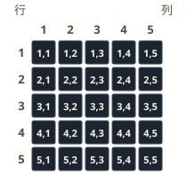
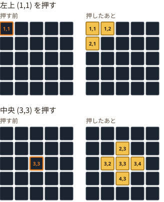
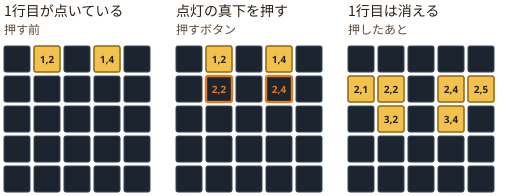
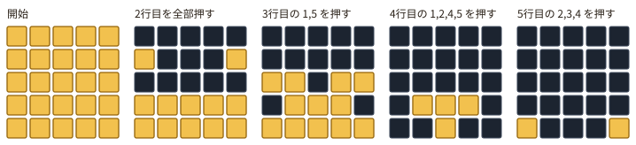
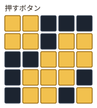

% Lights Out 5x5 の解法
% 2026-11-15 (Sun.)
% パズル 線形代数

$\def\F{\mathbb{F}}\def\press#1{\mathrm{press}(#1)}$

## ルールとその形式化

盤面は $5 \times 5$ のボタンで, 各ボタンは点灯か消灯のどちらかである.
ボタンの位置は $(i,j)$ と書く.
$i$ は上から数えた行, $j$ は左から数えた列で, どちらも $1$ から $5$ までである.
左上が $(1,1)$, 右上が $(1,5)$, 左下が $(5,1)$, 右下が $(5,5)$, 中央が $(3,3)$ である.

<figure style="margin: 0.5em auto; max-width: 280px"><figcaption>行は上から $1$, 列は左から $1$.$(i,j)$ の $i$ が行, $j$ が列.</figcaption></figure>

ボタンを1回押すと, そのボタンと上下左右に隣り合うボタンの点灯が反転する.
斜めは反転しない.盤の外にはみ出した分は何も起きない.

例えば左上 $(1,1)$ を押すと, $(1,1)$, $(1,2)$, $(2,1)$ の3つだけが反転する.
中央 $(3,3)$ を押すと, $(3,3)$ と $(2,3)$, $(4,3)$, $(3,2)$, $(3,4)$ の5つが反転する.
どちらも, 全部消えている状態から1回押したあとの点灯である.

<figure style="margin: 0.5em auto; max-width: 420px"><figcaption>消灯は暗いマス, 点灯は明るいマス.橙の文字が, いま押すボタン.</figcaption></figure>

目的は, 与えられた点灯の状態を, ボタンを何回か押して全部消すことである.

点灯を $1$, 消灯を $0$ と書く.
$\F_2 = \{0, 1\}$ とする.加法は次で定める.

$$
0 + 0 = 0, \qquad 0 + 1 = 1 + 0 = 1, \qquad 1 + 1 = 0
$$

この加法が点灯の反転に対応する.

状態は $\F_2^{5 \times 5}$ のベクトル $s = (s_{i,j})$ で表す.
$s_{i,j}$ はボタン $(i,j)$ の状態で, 点灯なら $1$, 消灯なら $0$ である.
全部消えている状態はゼロベクトルである.
初期状態を $b$, ボタンを押したあとの状態を $s$ と書くと, どちらもこの形のベクトルである.

ボタン $(i,j)$ を押したときの効果も, 同じ形のベクトル $\press{i,j}$ で書く.
$(k,\ell)$ 成分は, $(i,j)$ を押したときに $(k,\ell)$ が反転するなら $1$, しないなら $0$ である.

状態が $b$ のときに $(i,j)$ を押すと, 押したあとの状態 $s$ は

$$
s = b + \press{i,j}
$$

である.
とくに, 全部消えている状態で $(i,j)$ を1回押したあとの状態は $\press{i,j}$ そのものである.

## 自明な気づきと解の空間

同じボタンを2回押すと, その効果は消える.
反転は $\F_2$ の加法だからである.
押す順序を入れ替えても, 各ボタンが受ける反転の回数の偶奇は変わらない.

したがって, 解に必要な情報は「各ボタンを奇数回押すか, 偶数回押すか」だけである.
偶数回は0回, 奇数回は1回としてよい.
解は $\F_2^{5 \times 5}$ のベクトル $x = (x_{i,j})$ で,
$x_{i,j} = 1$ は $(i,j)$ を1回押すことを表す.
これは押すボタンの集合と同一視できる.
集合の対称差が, ベクトルの和に対応する.

初期状態を $b \in \F_2^{5 \times 5}$ とすると, 解くことは

$$
\sum_{i=1}^{5} \sum_{j=1}^{5} x_{i,j} \, \press{i,j} = b
$$

を満たす $x$ を求めることである.
左辺は $\F_2^{5 \times 5}$ 上の和なので, これは $\F_2^{5 \times 5}$ 上の線形方程式である.

全部消えている状態から始めて, 解 $x$ のボタンを押すと, 初期状態 $b$ と同じ点灯になる.
全部消えている状態は $b = 0$ である.
方程式の右辺がゼロなので, 押しても点灯がひとつも変わらない押し方を求めている.
そのような押し方の全体は $\F_2$ 上の部分空間で, これをこのパズルの解の自由度と呼ぶ.
点灯が残っている状態では, 解が1つあれば, それにこの部分空間を足したものが解の全体になる.

## 解の自由度は $\F_2^{5}$ 以下である

上の行から順に, 点いているボタンの真下を押すと, 2行目以降の押し方は1行目から一意に決まる.
この手順をライトチェイス (light chasing) と呼ぶ.

手順は次のとおり.

1. 1行目の押し方 $a = (a_1, a_2, a_3, a_4, a_5) \in \F_2^5$ を決めて, そのとおりに押す.
2. $i = 1, 2, 3, 4$ の順に, $i$ 行目でまだ点いている列 $j$ について, $(i+1, j)$ を押す.

<figure style="margin: 0.5em auto; max-width: 640px"><figcaption>点灯の真下を押すと, その行は消える.押した行とその下には, 新しい点灯が残る.</figcaption></figure>

$(i+1, j)$ を押すと, その上隣である $(i, j)$ が反転する.
この時点で $(i, j)$ は点いているので, 押した直後に消える.
同じ行の別の列を押しても $(i, j)$ は反転しない.
したがって, $i$ 行目を消すための $i+1$ 行目の押し方は, ライトチェイス以外にない.

ライトチェイスが終わると, 1行目から4行目はすべて消えている.
残るのは5行目だけである.
1行目の押し方は $2^5$ 通りなので, ライトチェイスで作れる押し方は高々 $2^5$ 通りである.

任意の解は, この形に直せる.
解 $x$ の1行目を $a$ としてライトチェイスを走らせると, 2行目以降は $x$ と一致する.
一致しなければ, その差は1行目を押さずに2行目以降だけで上4行を消す押し方になるが, 各行の消し方は一意なので, そのような差はゼロしかない.

したがって, 解を探す範囲は $\F_2^5$ の $a$ で足りる.
解の空間の次元は5以下である.

## 射影函数 $h$ の定義

初期状態は, 1行目から5行目まで全部消えているとする.
1行目を $a \in \F_2^5$ のとおりに押し, ライトチェイスで2行目以降を決める.

このとき1行目から4行目は消え, 5行目だけが残る.
残った5行目を $h(a) \in \F_2^5$ と書く.

押す操作は線形で, ライトチェイスの各ステップも「点いている場所の真下を押す」という線形な規則なので, $h$ は線形である.
$e_1, \ldots, e_5$ を $\F_2^5$ の標準基底とする.

$$\begin{align*}
e_1 & = (1,0,0,0,0) \\
e_2 & = (0,1,0,0,0) \\
e_3 & = (0,0,1,0,0) \\
e_4 & = (0,0,0,1,0) \\
e_5 & = (0,0,0,0,1)
\end{align*}$$

全部消えている状態から $e_j$ を押し, 点いているボタンの真下を順に押した結果は次のとおり.
各ブロックの上段が押したボタン, 下段が残った5行目, つまり $h(e_j)$ である.

$j = 1$:

$$
\begin{array}{c|ccccc}
\text{press} & 1 & 0 & 0 & 0 & 0 \\
 & 1 & 1 & 0 & 0 & 0 \\
 & 1 & 0 & 1 & 0 & 0 \\
 & 0 & 1 & 1 & 1 & 0 \\
 & 0 & 0 & 0 & 0 & 1 \\
\hline
h(e_1) & 0 & 1 & 1 & 0 & 1
\end{array}
$$

$j = 2$:

$$
\begin{array}{c|ccccc}
\text{press} & 0 & 1 & 0 & 0 & 0 \\
 & 1 & 1 & 1 & 0 & 0 \\
 & 0 & 0 & 0 & 1 & 0 \\
 & 1 & 1 & 0 & 1 & 1 \\
 & 0 & 0 & 0 & 1 & 0 \\
\hline
h(e_2) & 1 & 1 & 1 & 0 & 0
\end{array}
$$

$j = 3$:

$$
\begin{array}{c|ccccc}
\text{press} & 0 & 0 & 1 & 0 & 0 \\
 & 0 & 1 & 1 & 1 & 0 \\
 & 1 & 0 & 0 & 0 & 1 \\
 & 1 & 0 & 1 & 0 & 1 \\
 & 0 & 0 & 1 & 0 & 0 \\
\hline
h(e_3) & 1 & 1 & 0 & 1 & 1
\end{array}
$$

$j = 4$:

$$
\begin{array}{c|ccccc}
\text{press} & 0 & 0 & 0 & 1 & 0 \\
 & 0 & 0 & 1 & 1 & 1 \\
 & 0 & 1 & 0 & 0 & 0 \\
 & 1 & 1 & 0 & 1 & 1 \\
 & 0 & 1 & 0 & 0 & 0 \\
\hline
h(e_4) & 0 & 0 & 1 & 1 & 1
\end{array}
$$

$j = 5$:

$$
\begin{array}{c|ccccc}
\text{press} & 0 & 0 & 0 & 0 & 1 \\
 & 0 & 0 & 0 & 1 & 1 \\
 & 0 & 0 & 1 & 0 & 1 \\
 & 0 & 1 & 1 & 1 & 0 \\
 & 1 & 0 & 0 & 0 & 0 \\
\hline
h(e_5) & 1 & 0 & 1 & 1 & 0
\end{array}
$$

$h$ の線形性から, 任意の $a = (a_1, \ldots, a_5) \in \F_2^5$ に対して,

$$h(a) = \sum_j a_j h(e_j)$$

である. 例えば
$$h(1,1,0,0,0) = h(e_1) + h(e_2) = (0,1,1,0,1) + (1,1,1,0,0) = (1,0,0,0,1)$$
とわかる.

この5本の和を見ると, 次の2つの関係がある.

$$
h(e_2) + h(e_3) + h(e_4) = 0
$$

$$
h(e_1) + h(e_3) + h(e_5) = 0
$$

成分ごとに足すと, どちらも $(0,0,0,0,0)$ になる.

## $h$ を用いた素朴な解法

与えられた状態 $b$ を, 次の順で解く.

1. 1行目は押さない.$a = 0$ としてライトチェイスし, 2行目から5行目を決める.1行目から4行目は消える.残った5行目を $b^{(5)} \in \F_2^5$ とする.
2. $h(a) = b^{(5)}$ となる $a \in \F_2^5$ を求める.
3. その $a$ を1行目の押し方として, もう一度ライトチェイスする.

2が解を持てば, 3の押し方は $b$ を全部消す.
理由は線形性である.
$a = 0$ でライトチェイスした押し方を $x_0$ とすると, $x_0$ は $b + (0,0,0,0,b^{(5)})$ を作る.
ここで $(0,0,0,0,b^{(5)})$ は, 上4行が消えて5行目だけが $b^{(5)}$ である状態を表す.
$h(a) = b^{(5)}$ となる $a$ から作った押し方を $x_a$ とすると, $x_a$ は全部消えている状態から $(0,0,0,0,b^{(5)})$ を作る.
$x_0 + x_a$ は $b$ を作る.
ライトチェイスは1行目を決めれば2行目以降が一意なので, $x_0 + x_a$ は, 1行目を $a$ として $b$ からライトチェイスした押し方と一致する.

$h(a) = b^{(5)}$ を, $a = (a_1,\ldots,a_5)$ と書いて解くと

$$
a_1 h(e_1) + a_2 h(e_2) + a_3 h(e_3) + a_4 h(e_4) + a_5 h(e_5) = b^{(5)}
$$

である.
$a$ は $2^5 = 32$ 通りなので, この式を満たす $a$ は, 残り $b^{(5)}$ ごとに列挙して調べられる.

### 例

全部点いている状態では, 1行目を押さないライトチェイスのあと, 5行目は $(1,0,0,0,1)$ になる.
上で計算した $h(1,1,0,0,0) = (1,0,0,0,1)$ なので, $(1,1,0,0,0)$ はこの残りを消す1行目の押し方である.
この値を上の式の右辺に置いて 32 通りを調べると, 次の4つが解になる.

$$
(1,1,0,0,0), \quad
(1,0,1,1,0), \quad
(0,1,1,0,1), \quad
(0,0,0,1,1)
$$

このうち $(1,1,0,0,0)$ で, 最初からライトチェイスし直す.
1行目を押さない場合の途中経過は, 次のとおりである.

<figure style="margin: 0.5em auto; max-width: 760px"><figcaption>明るいマスが点灯。各段階の見出しが、その直前に押したボタン。</figcaption></figure>

残った5行目は $b^{(5)} = (1,0,0,0,1)$ である.
上で列挙した $a = (1,1,0,0,0)$ で最初からライトチェイスし直すと, 押すボタンは次のとおりである.
この押し方で全部消える.

<figure style="margin: 0.5em auto; max-width: 220px"><figcaption>明るいマスを1回押す。暗いマスは押さない。</figcaption></figure>

## 解の自由度は $\F_2^{3}$ 以下である

前節の5本の和から, 次の2つの関係が出る.

$$
h(e_4) = h(e_2) + h(e_3), \qquad h(e_5) = h(e_1) + h(e_3)
$$

したがって $h(e_4)$ と $h(e_5)$ は $h(e_1), h(e_2), h(e_3)$ の和で書ける.
この3本は一次独立である.
3本を列に並べた行列の先頭3行は

$$
\begin{pmatrix}
0 & 1 & 1 \\
1 & 1 & 1 \\
1 & 1 & 0
\end{pmatrix}
$$

で, 行列式は $\F_2$ 上で $1$ である.
したがって $h(e_1), \ldots, h(e_5)$ が張る空間の次元は3である.
$h$ の像の次元は3, 核の次元は $5 - 3 = 2$ である.

## $h(a) = b^{(5)}$ を式で解く

この関係を使うと, 32通りを全部試さなくても $h(a) = b^{(5)}$ が解ける.
$a = (a_1,\ldots,a_5)$ と書くと, 定義から

$$
h(a) = a_1 h(e_1) + a_2 h(e_2) + a_3 h(e_3) + a_4 h(e_4) + a_5 h(e_5)
$$

である.
ここに $h(e_4) = h(e_2) + h(e_3)$ と $h(e_5) = h(e_1) + h(e_3)$ を代入する.

$$
\begin{align*}
h(a)
&= a_1 h(e_1) + a_2 h(e_2) + a_3 h(e_3) \\
&\quad + a_4 \bigl(h(e_2) + h(e_3)\bigr) + a_5 \bigl(h(e_1) + h(e_3)\bigr) \\
&= (a_1 + a_5) \, h(e_1) + (a_2 + a_4) \, h(e_2) + (a_3 + a_4 + a_5) \, h(e_3)
\end{align*}
$$

したがって $h(a) = b^{(5)}$ は

$$
(a_1 + a_5) \, h(e_1) + (a_2 + a_4) \, h(e_2) + (a_3 + a_4 + a_5) \, h(e_3) = b^{(5)}
$$

である.
$x = a_1 + a_5$, $y = a_2 + a_4$, $z = a_3 + a_4 + a_5$ と置く.
一次独立なので, 解があるとき $x, y, z$ は一意に決まる.
$b^{(5)} = (b_1, b_2, b_3, b_4, b_5)$ と書くと,

$$
\begin{align*}
y + z &= b_1 \\
x + y + z &= b_2 \\
x + y &= b_3 \\
z &= b_4 \\
x + z &= b_5
\end{align*}
$$

である.
第4式から $z = b_4$, 第1式から $y = b_1 + b_4$, 第3式から $x = b_1 + b_3 + b_4$ が出る.
これを第2式と第5式に代入して消すと, 可解条件は

$$
b_2 + b_3 + b_4 = 0, \qquad b_1 + b_3 + b_5 = 0
$$

の2本である.
この2本は独立で, どちらも成り立つ $b^{(5)}$ は $2^{5-2} = 8$ 個ある.
これは $h(e_1), h(e_2), h(e_3)$ が張る空間の大きさに一致する.

条件を満たすとき, 特殊解は $a_4 = a_5 = 0$ と置いて

$$
a_1 = b_1 + b_3 + b_4, \qquad a_2 = b_1 + b_4, \qquad a_3 = b_4
$$

でよい.
一般解は, 次に書く核を足したものである.

核は, 上の2本の関係そのものである.

$$
h(e_2 + e_3 + e_4) = 0, \qquad h(e_1 + e_3 + e_5) = 0
$$

この2本は一次独立で, 核の基底になる.
対応する1行目の押し方は

$$
(0,1,1,1,0), \qquad (1,0,1,0,1)
$$

である.
どちらも, 全部消えている状態に対してライトチェイスすると, 5行目まで含めて全部消える.
つまり, 状態を変えない非自明な押し方が少なくとも2次元ある.

したがって, 方程式 $\sum x_{i,j} \press{i,j} = b$ の係数行列は, 列が25本, 核が少なくとも2次元なので, 階数は23以下である.
解がある $b$ は全体の $2^{23}$ 個以下, 割合にして $1/4$ 以下である.

ライトチェイスで解ける状態は, 残った $b^{(5)}$ が $h$ の像に入るものだけである.
像は8個なので, 1行目を押さないライトチェイスのあとで解がある割合は, 残差がこの8個のどれかに落ちる場合に限られる.
全部の初期状態 $2^{25}$ 個のうち, 実際に解を持つものは $2^{23}$ 個で, ちょうど $1/4$ である.
これは核の次元がちょうど2であることと一致する.
上の「23以下」「$1/4$ 以下」は, この数え上げで等号になる.

1行目だけを見ると, 自由に決められるのは3成分ではない.
$a_4$ と $a_5$ を自由に選ぶと, $x, y, z$ から

$$
a_1 = x + a_5, \qquad a_2 = y + a_4, \qquad a_3 = z + a_4 + a_5
$$

で残りの3成分が決まる.
自由なのは2成分で, 特殊解を1つ決めれば, 解は高々4個である.

「3つのボタンだけを考えればよい」は, 次の意味で成り立つ.
$h(e_4)$ と $h(e_5)$ は $h(e_2) + h(e_3)$ と $h(e_1) + h(e_3)$ なので,
$a_4 = a_5 = 0$ に制限しても $h$ の像は減らない.
解が存在する状態には, $a_4 = a_5 = 0$ である解が必ず1つある.
その解の1行目で実際に押すかもしれないのは, 1列目, 2列目, 3列目の3つだけである.
残りの2列は, 解の個数を4個まで増やすときにだけ押す.

全部点いている状態では, 特殊解 $(1,1,0,0,0)$ に核の2本を足して, 1行目は次の4通りになる.

$$
(1,1,0,0,0), \quad
(1,0,1,1,0), \quad
(0,1,1,0,1), \quad
(0,0,0,1,1)
$$

4通りとも, ライトチェイスを続けると状態は全部消える.
